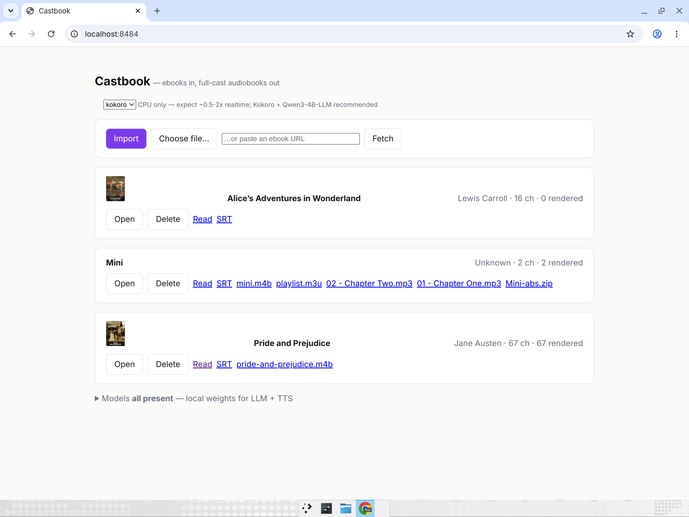
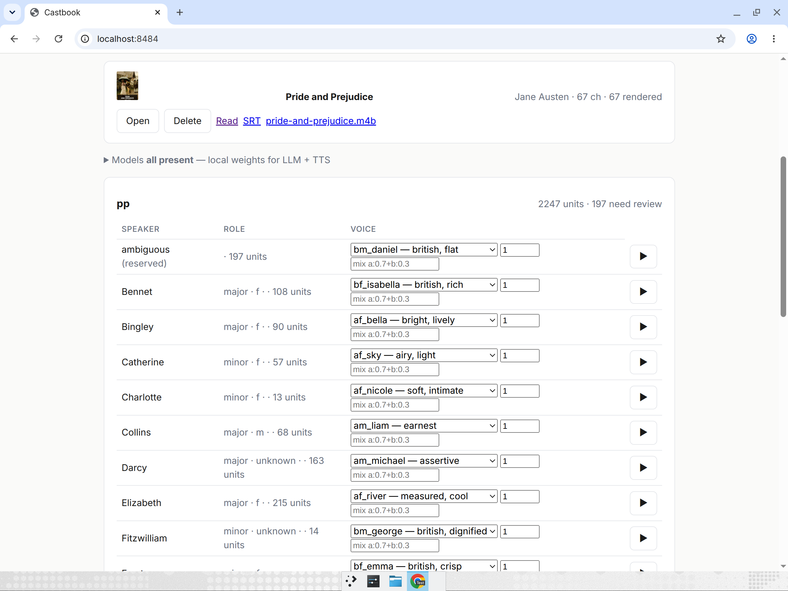
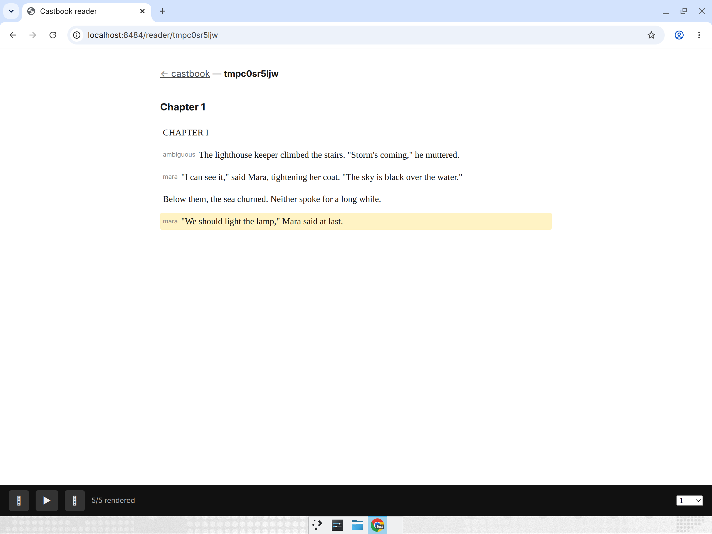

# Castbook

Turn any ebook into a full-cast audiobook — every character gets a consistent
voice, a narrator reads the rest. Free, open-source, local-first.

EPUB, PDF, TXT and MOBI/AZW3 in, chaptered M4B out. Python CLI plus a minimal local web UI.

## Hear it

Same *Pride and Prejudice* passage — once as a flat single voice, once cast:

- [Flat single-voice](demo/flat-15s.mp3) (22s) / [full passage](demo/flat.mp3)
- [Full cast](demo/cast-15s.mp3) (22s) / [full passage](demo/cast.mp3) — Bingley,
  Elizabeth, Kitty, Mr. & Mrs. Bennet and the narrator get distinct voices





## Quickstart

```bash
uv venv && uv pip install -e '.[dev]'
castbook models pull kokoro-v1 kokoro-voices-v1   # ~350 MB, required for the kokoro backend

# faster alternative on CPU (cloning + streaming), optional:
pip install -e '.[pocket]'   # torch CPU wheel first: pip install torch --index-url https://download.pytorch.org/whl/cpu
# then set backend = "pocket" under [tts] in config.toml — the model auto-downloads from HF.
# clone a voice: castbook clone <book> <speaker> /path/to/clip.wav (requires HF terms
# accepted for kyutai/pocket-tts); catalog voices need no auth.

# quality tier (GPU only — check 'castbook doctor' for your tier):
pip install -e '.[qwen]'     # Qwen3-TTS VoiceDesign: every character gets a designed voice
# then backend = "qwen" under [tts]. Each character's vibe note becomes the voice description.
castbook models pull qwen3-4b-q4                  # ~2.5 GB, optional — better attribution
castbook run book.epub          # parse → analyze → cast → generate → export
castbook run examples/lighthouse.txt   # or try the bundled sample
```

Output lands in `books/<book-id>/export/`. Stages resume where they left off;
re-run `castbook generate` after a crash or a casting change and only
un-rendered units are synthesized.

## Commands

| command | what it does |
|---|---|
| `castbook import <file\|dir\|url> […]` | import ebooks (EPUB/PDF/TXT/MD/MOBI/AZW3) — files, a whole directory, or http(s) URLs → `chapters.json` |
| `castbook analyze <book>` | attribute every line (`--backend heuristic\|llamacpp\|hybrid` — hybrid = heuristic + LLM second look) |
| `castbook clone <book> <sp> <clip>` | clone a voice from a wav/mp3/flac clip onto a speaker (pocket only) |
| `castbook cast <book>` | auto-assign voices; `--map name=voice` (mix voices as `a:0.7+b:0.3`), `--speed name=rate` |
| `castbook generate <book>` | synthesize audio (resumable; `--chapters 1-3,7`, `--limit 50` preview, `--workers 4` parallel, `--align` word timestamps) |
| `castbook export <book>` | mux chaptered M4B (+ `--format mp3`/`both`, `--epub` read-along EPUB3) |
| `castbook review <book>` | list ambiguous units; `--set unit=speaker` to fix |
| `castbook merge <book> <a> <b>` | fold duplicate speaker `a` into `b` |
| `castbook align <book>` | word-level timestamps for reader karaoke (needs `[align]` extra) |
| `castbook reset <book>` | wipe a book's artifacts to start over |
| `castbook run <file>` | all of the above |
| `castbook books` | list books with render progress |
| `castbook models list\|pull` | model management |
| `castbook serve -p 8484` | local web UI (`--host 0.0.0.0` shares on LAN behind a printed token) |
| `castbook transcript <book>` | per-chapter SRT/VTT/TXT with speaker labels (`--fmt`, `-o`, `--speaker name` for one character) |
| `castbook search <book> <text>` | who said it: every matching unit with chapter, speaker, excerpt |
| `castbook rename <book> <sp> <name>` | rename a character (old name kept as an alias) |
| `castbook chapters <book>` | chapter indexes, titles, word counts |
| `castbook verify <book>` | health check: coverage, failed units, chapter gaps, stale export |
| `castbook import <files> --lang fr` | override detected language (misdetected epubs) |
| `castbook export <book> --split 8` | split the M4B into parts of at most N hours |

## Docker

```bash
docker build -t castbook .
docker run -v $PWD/data:/data castbook doctor
```

## Web UI

`castbook serve` then open `http://localhost:8484`: pick the TTS backend in the header (kokoro/pocket/qwen — switching drops stale castings so you recast), pull models from the Models panel, import files (multi-select, drag-and-drop, or an http(s) ebook URL — private-network URLs are refused), audition voices
with the ▶ button, review and
override voice casting (including per-speaker speed, `voiceA:0.7+voiceB:0.3` mixes, and merging duplicate speakers), generate (or "Preview 50" for a quick sample), play any rendered chapter with ▶ audio, re-render just a range with ↻, and export in the background — download the M4B when it lands.
The reader view highlights the spoken word when `castbook align` has run, remembers
your position, and supports space/←/→/↑/↓ shortcuts.
Each book also gets a podcast feed (`/api/books/<id>/feed.xml` — subscribe in any
podcast app) and the whole library is browsable as an OPDS catalog at
`/api/opds` (KyBook, Panels, etc.). `export --epub` produces a read-along
EPUB3 with word-level media overlays for Thorium/Apple Books.

Voice assignments persist across books (`data/voice-memory.json`) — a character
keeps their voice everywhere they appear. Pronunciation overrides live in
`data/lexicon.json` (global) and `<book>/lexicon.json` (per-book, wins on conflicts).

## Attribution

Without the LLM, a heuristic attributor tags explicit speech verbs
("said Elizabeth") and leaves the rest `ambiguous` — those units land in
`needs_review` in `attribution.json` rather than being guessed. With
`qwen3-4b-q4` downloaded, `analyze` uses it via llama.cpp (CPU) for
pronoun/context resolution.

## Eval

`python -m eval.run` scores speaker attribution on labeled excerpts (Pride &
Prejudice ch. I-II, Alice's Mad Tea-Party) and writes `eval/report.md`.
Current numbers (Qwen3-4B, CPU): **alice 95% · pride-and-prejudice 85%** —
misses are ambiguous-vs-character granularity, surfaced in `needs_review`
rather than silently misattributed.

## FAQ

**Is it legal?** For legally acquired, DRM-free books only. Castbook removes no
DRM and uploads nothing. Output is for personal use.

**Does my book leave the machine?** No. Parsing, attribution, voices and export
all run locally; there is no telemetry.

**Do I need a GPU?** No — Kokoro and Pocket-TTS render on CPU. A GPU unlocks
the Qwen3-TTS VoiceDesign tier (per-character designed voices); run
`castbook doctor` for your machine's tier.

## Legality

For legally acquired, DRM-free books only. Castbook removes no DRM and uploads
nothing — everything runs on your machine. Output is for personal use.
Bundled models: Kokoro (Apache-2.0), Qwen3 (Apache-2.0).
